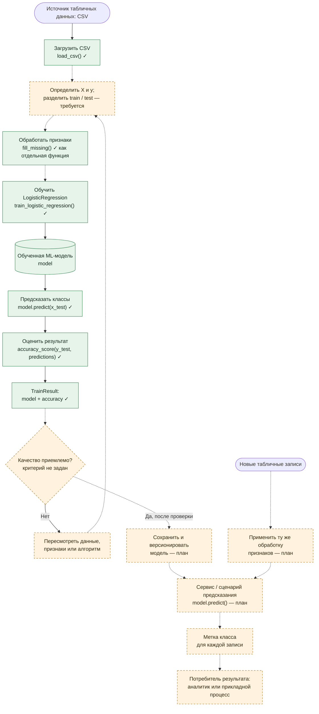

# Model BPMN: место ML-модели в техническом процессе проекта

**Проект:** ML Project Demo
**ML-компонент:** `sklearn.linear_model.LogisticRegression`
**Тип задачи:** классификация табличных объектов по размеченным примерам.

> **Границы схемы.** Проект представляет собой учебный прототип, а не готовый продукт: его бизнес-домен и потребитель предсказаний не заданы. Поэтому ниже показан **технический процесс обучения и оценки**, а использование предсказаний в прикладной системе — как **планируемое расширение**. Это процессная схема в нотации Mermaid с задачами, развилкой и потоками, а не формальный BPMN 2.0 XML.

## 1. Схема процесса

Диаграмма открывается в GitHub непосредственно в Markdown. **Сплошные связи** соединяют фактические операции или показывают их логическую последовательность; **пунктирные** указывают на ещё не реализованные связи и этапы. Отдельные реализованные функции сейчас не собраны в единый исполняемый сценарий.

**Смысл развилки:** решение о достаточности качества пока принимает разработчик в ходе эксперимента; автоматической проверки по порогу и заданного целевого значения `accuracy` в коде нет. Точно так же сохранение модели, загрузка сохранённого артефакта и применение к новым данным ещё не реализованы.

## 2. Какую задачу решает модель

Входящему объекту, представленному набором признаков, нужно сопоставить **класс**, изученный на размеченных наблюдениях. Для этого функция [`train_logistic_regression()`](src/models/trainer.py) обучает логистическую регрессию на `x_train`, `y_train`, получает предсказания для `x_test` и возвращает модель и числовую оценку её точности.

В рамках текущего проекта практическая ценность модели — показать полный ML-этап «обучение → прогноз на тесте → оценка». Конкретное бизнес-действие по результату класса не определено, поскольку предметная область и целевые метки отсутствуют.

## 3. Почему здесь целесообразно использовать ML

Если классы определяются не одним очевидным правилом, а сочетанием признаков, логистическая регрессия обучает зависимость по размеченным примерам без ручного перечисления всех условий. Для учебного проекта это удобный **baseline**: алгоритм относительно прост, быстро обучается на типичных табличных данных, а коэффициенты могут помогать интерпретировать влияние признаков. Необходимость ML вместо обычных правил должна быть подтверждена сравнением на выбранном датасете; такого сравнения пока нет.

## 4. Какие данные поступают на вход

| Компонент процесса | Вход | Особенности |
| --- | --- | --- |
| Загрузка `load_csv()` | Путь к файлу CSV | В конфигурации ожидается `data/train.csv`, которого нет в архиве |
| Подготовка `fill_missing()` | Таблица `pd.DataFrame` | Заполняет пропуски в **числовых** столбцах; стратегии: `mean`, `median`, `zero` |
| Обучение модели | `x_train: pd.DataFrame`, `y_train: pd.Series` | Таблица признаков и соответствующие метки класса |
| Проверка модели | `x_test: pd.DataFrame`, `y_test: pd.Series` | Совместимые признаки и истинные метки для расчёта Accuracy |
| Будущее применение | Новые записи с теми же признаками | Потребуется повторить обученную предобработку и вызвать `predict()` |

**Важное условие качества:** параметры заполнения пропусков и иных преобразований должны вычисляться только по обучающей выборке, а затем использоваться без переобучения на тестовых и новых объектах. Существующая `fill_missing()` этого состояния не сохраняет; для полноценного конвейера нужен `Pipeline` / `SimpleImputer` или аналогичная логика.

## 5. Как используется результат дальше

**Реализовано сейчас.** После `model.predict(x_test)` в [`trainer.py`](src/models/trainer.py) выполняется `accuracy_score(y_test, predictions)`. Функция возвращает `TrainResult`, содержащий обученный объект модели и число `accuracy`. Эти результаты может просмотреть код, вызвавший функцию, и использовать для учебного анализа качества. Сохранение и дальнейшая передача результата внешней системе отсутствуют.

**Предполагаемое развитие.** При достижении заранее определённого критерия качества модель можно сохранить, подключить к пакетной обработке или API, передавать в неё новые записи и использовать метку класса как **подсказку** для аналитика или очередного программного шага. Что именно делать с каждым классом, должно быть сформулировано отдельно на уровне бизнес-процесса; сейчас такого правила в проекте нет.

## 6. Что реализовано и что ещё требуется

| Этап | Состояние | Где смотреть / что добавить |
| --- | --- | --- |
| Чтение CSV | Реализована отдельная функция | [`src/data/loader.py`](src/data/loader.py) |
| Заполнение числовых пропусков | Реализована отдельная функция | [`src/features/transformer.py`](src/features/transformer.py) |
| Обучение и Accuracy | Реализована функция | [`src/models/trainer.py`](src/models/trainer.py) |
| Подготовка целевого столбца и разбиение | Не реализованы | Добавить воспроизводимый сценарий |
| Единая, обучаемая на train предобработка | Не реализована | Добавить sklearn `Pipeline` |
| Проверка метрик / критерий приёмки | Частично (только Accuracy) | Добавить отчёт с F1, Precision, Recall, baseline и критерием |
| Сохранение, выдача предсказаний новым данным | Не реализованы | Добавить сериализацию и пакетный процесс или API |
| Использование предсказания в бизнес-процессе | Не определено | Задать предметную область и реакцию на каждый класс |

**Подробная документация модели:** [`model_card.md`](model_card.md).
