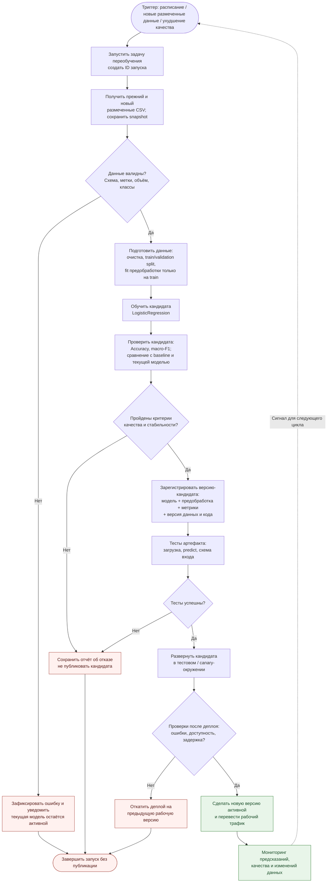

# Model Retrain BPMN: автоматическое переобучение и публикация модели

**Проект:** ML Project Demo
**ML-модель:** `sklearn.linear_model.LogisticRegression` (классификация табличных данных)
**Статус:** **проектируемый процесс**, а не уже работающая автоматизация.

В исходном проекте реализованы отдельные функции `load_csv()` для чтения CSV, `fill_missing()` для заполнения числовых пропусков и `train_logistic_regression()` для обучения и вычисления Accuracy. В репозитории пока **нет** обучающего CSV, единого запуска переобучения, мониторинга, реестра моделей и сервиса деплоя. Ниже описан целевой процесс, который можно реализовать поэтапно. Диаграмма Mermaid отображается непосредственно в GitHub; она показывает логику процесса, но не является BPMN 2.0 XML.

## 1. Схема процесса автоматического переобучения

**Принцип безопасности:** кандидат не заменяет текущую модель, пока не пройдены проверки данных, качества и работоспособности. При отказе на любом этапе фиксируется причина, отправляется уведомление, а ранее опубликованная версия остаётся доступной. Если первой опубликованной версии ещё нет, процесс завершается без деплоя.

## 2. Этапы: действие, вход и результат

| Этап | Что происходит | Что поступает на вход | Что передаётся дальше |
| --- | --- | --- | --- |
| **1. Триггер и запуск** | Оркестратор инициирует задачу по расписанию (например, еженедельно), при появлении новых размеченных записей или по сигналу мониторинга. Повторные параллельные запуски блокируются. | Событие или расписание, настройки пайплайна | ID запуска, конфигурация и запись в журнале |
| **2. Сбор данных** | Считываются исходный набор (`data/train.csv` — путь из `configs/config.yaml`) и новый согласованный размеченный CSV; формируется неизменяемый снимок объединённых данных. | Старые и новые данные с признаками и целевой меткой | Версионированный датасет и описание его происхождения |
| **3. Валидация данных** | Проверяются наличие файла, ожидаемая схема признаков и типов, отсутствие пустых меток, дубли, допустимые значения, минимум два класса и достаточность данных для разбиения. | Снимок датасета | Отчёт проверки; при ошибке — остановка без публикации |
| **4. Подготовка** | Выделяется целевая колонка, выполняется разбиение на train и validation с учётом классов, обучение импутации и иных преобразований **только на train**. На validation применяются те же преобразования. | Проверенный датасет и правила подготовки | `X_train`, `y_train`, `X_val`, `y_val`, обученная предобработка |
| **5. Обучение** | Обучается новая логистическая регрессия; фиксируются параметры (`max_iter=1000` в текущем коде), seed, версия данных и кода. | Подготовленная обучающая выборка | Модель-кандидат и метаданные эксперимента |
| **6. Оценка** | На отложенной validation-выборке рассчитываются Accuracy и **macro-F1**; на **той же** выборке оцениваются действующая модель и простой baseline (наиболее частый класс). | Кандидат, validation, действующая модель (если есть) | Отчёт с сопоставимыми метриками и выявленными ошибками |
| **7. Решение о публикации** | Автоматические условия допуска проверяются в указанном ниже порядке. | Отчёт качества, пороги, метрики действующей версии | Решение `approved` или `rejected` с причиной |
| **8. Регистрация** | Для одобренной версии сохраняются модель **вместе с предобработкой**, метрики, дата, ID запуска, версии кода и данных. Версия получает статус `candidate`, но ещё не становится рабочей. | Одобренный кандидат | Версионированный артефакт и его идентификатор |
| **9. Тесты и деплой** | Проверяется загрузка артефакта, формат входа и `predict()`; затем кандидат развёртывается сначала в тестовой или canary-среде. | Артефакт-кандидат и тестовый набор запросов | Результаты smoke-тестов, метрики доступности и ошибок |
| **10. Активация / откат** | Если проверки успешны, новая версия становится `active`. При ошибках сервис возвращается к предыдущей рабочей версии. | Отчёт проверок после деплоя | Рабочая версия модели либо запись об откате |
| **11. Мониторинг** | Контролируются доступность, ошибки, распределения признаков и — когда появляются истинные метки — качество прогнозов; ухудшение может вызвать следующий запуск. | Предсказания, новые данные и фактические метки (если доступны) | Сигнал тревоги, отчёт мониторинга или следующий триггер |

## 3. Условия, при которых новая версия попадает в эксплуатацию

Предлагаемая **автоматическая политика допуска** (её реализация и пороги пока отсутствуют в коде):

1. **Проверка данных пройдена.** Схема совпадает с ожидаемой, целевая метка заполнена, в обучающей выборке есть минимум два класса, разбиение возможно; проверка на утечку признаков не выявила проблем.
2. **Качество не ниже заданного уровня.** `Accuracy_new >= ACCURACY_MIN` и `macro_F1_new >= MACRO_F1_MIN`. Значения `ACCURACY_MIN` и `MACRO_F1_MIN` должны быть заданы и обоснованы на выбранном датасете **до** включения автоматического деплоя; в существующем проекте они не установлены.
3. **Есть преимущество над простым baseline.** `Accuracy_new > Accuracy_majority_baseline` на той же validation-выборке. Для несбалансированных классов дополнительно обязателен `macro-F1`, а не только Accuracy.
4. **Нет ухудшения относительно действующей модели.** Если уже есть `active`-версия, на **одной и той же** validation-выборке выполняется `Accuracy_new >= Accuracy_active` и `macro_F1_new >= macro_F1_active`. Для первой публикации этот пункт пропускается, но обязательные минимальные пороги и baseline остаются.
5. **Артефакт работоспособен.** Проверка загрузки модели и предобработки, корректности `predict()` и совместимости входной схемы успешна; после canary-деплоя нет критических ошибок и нарушений заданных эксплуатационных лимитов.

**Если хотя бы одно условие не выполнено или необходимый порог не настроен:** статус кандидата — `rejected`, новая версия **не активируется**. В журнал записываются ID запуска, метрики и причина; ответственный получает уведомление. При технической ошибке деплоя выполняется **rollback** к последней стабильной версии.

> **Как избежать завышенной оценки:** параметры предобработки подбирать только на train, не использовать validation для обучения кандидата, сравнивать версии на одинаковых наблюдениях; после настройки процесса иметь отдельную финальную тестовую выборку для независимой периодической проверки. Повторный подбор по одной validation-выборке со временем также может приводить к переобучению на неё.

## 4. Что есть в проекте и что потребуется добавить

| Компонент | Состояние в текущем репозитории | Предлагаемая реализация |
| --- | --- | --- |
| Загрузка CSV | **Есть:** [`src/data/loader.py`](src/data/loader.py), `load_csv()` | Получение новых размеченных данных и создание снимков |
| Заполнение пропусков | **Есть:** [`src/features/transformer.py`](src/features/transformer.py), `fill_missing()` | `sklearn.pipeline.Pipeline` с `SimpleImputer` и нужными преобразованиями, обучаемыми только на train |
| Логистическая регрессия / Accuracy | **Есть:** [`src/models/trainer.py`](src/models/trainer.py), `TrainResult(model, accuracy)` | Дополнительная `macro-F1`, сравнение версий и baseline, отчёт в JSON |
| Запуск переобучения | **Нет** | Отдельный сценарий `retrain.py`, вызываемый планировщиком или GitHub Actions по расписанию |
| Критерии публикации | **Нет** | Значения порогов в конфигурации и автоматический quality gate |
| Версии артефактов | **Нет** | Хранилище артефактов (`model.joblib` / `Pipeline`, `metrics.json`, `metadata.json`) и указатель на `active`-версию; MLflow — возможное дальнейшее расширение |
| Деплой, откат, мониторинг | **Нет** | Пакетный сервис или API, canary-проверки, контроль показателей и возврат к предыдущей версии |
| CI | **Есть:** [`.github/workflows/ci.yml`](.github/workflows/ci.yml) запускает lint, format, pytest при push/PR | Отдельный workflow переобучения; **текущий CI не обучает и не развёртывает модель** |

**Итог:** схема задаёт последовательность автоматического переобучения — **триггер → данные → валидация → подготовка → обучение → оценка → решение → регистрация → деплой → мониторинг / откат**. Пока это план внедрения; утверждать, что автоматическое переобучение уже работает, нельзя.

**Связанные файлы:** [`model_card.md`](model_card.md) — Model Card; [`Model_BPMN.md`](Model_BPMN.md) — место модели в основном процессе.
